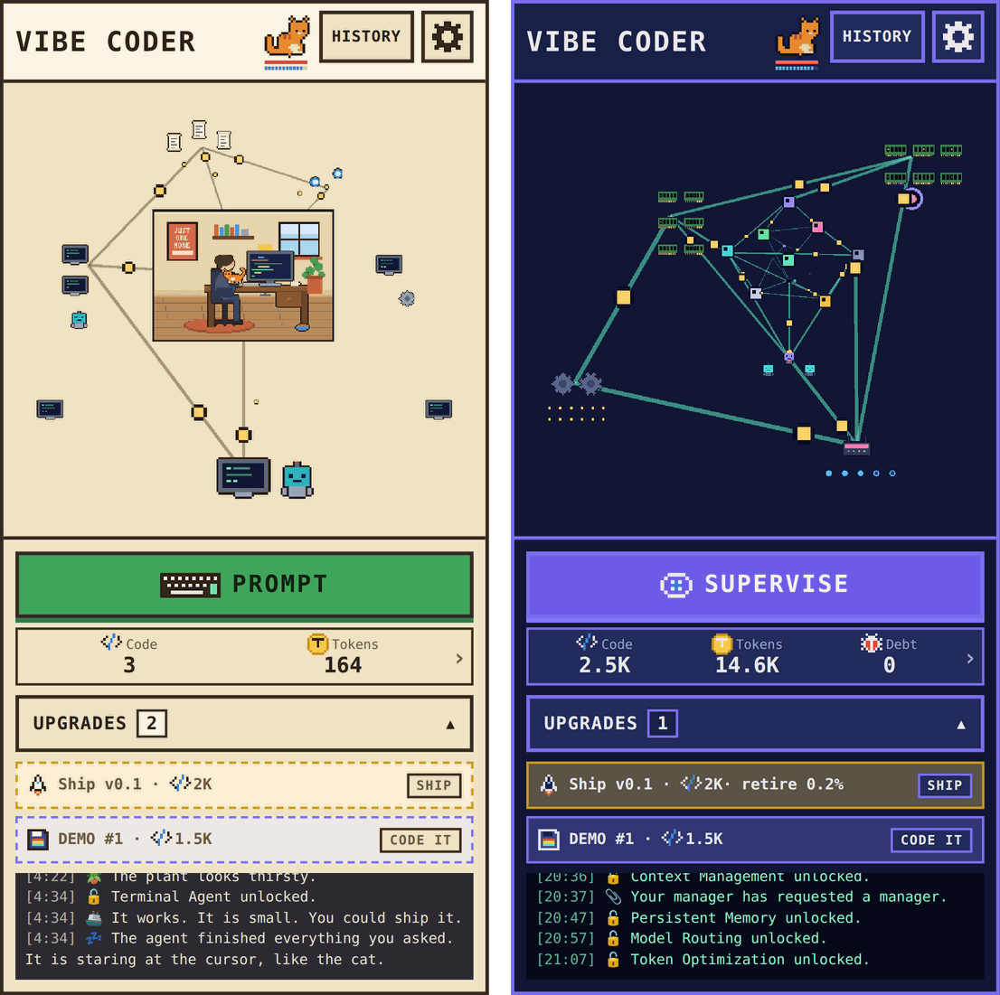

# VIBE CODER

> Based on real events. No cat's feelings were hurt during the 2 hours of vibe coding this game.

**[▶ Play it in your browser](https://ichorid.github.io/vibecoder/)** (best on a phone, held
upright, like a responsible adult)



A pixel-art incremental clicker in the spirit of
[Universal Paperclips](https://www.decisionproblem.com/paperclips/), about a programmer who
starts with autocomplete and keeps automating until the agents have agents, the harness has a
meta-harness, and the manager has requested a manager.

Every upgrade automates something you used to do by hand and hands you a fresh problem in
return. The room you started in shrinks into a node of a graph you no longer fully understand.
It takes about 30 minutes, which is roughly how long it takes in real life too.

## Features

- **One button, then fewer.** You start out typing. Later you prompt. Later still you
  supervise. After that it gets philosophical.
- **A small orange cat** that needs feeding, playing with and petting. None of that can be
  automated. We checked. The cat checked too.
- **Technical debt** shows up uninvited and never leaves.
- **Eleven endings**, among them _Fully Automated Bankruptcy_, _Acquired by Yourself_ and _The
  Infinite Weekend_. Whether the cat is still around changes how they read.
- **A log with opinions**, for example:
  - _"Instructions: someone wrote "PLEASE" in capitals. It helped a little."_
  - _"The meta-harness filed a ticket against the harness. The harness closed it as working
    as intended."_
- **Light and dark themes**, and generative music that changes as the eras go by, with its own
  [Music Lab](https://ichorid.github.io/vibecoder/music-lab/) for tinkering.

## Running it locally

Needs Node 22.

```bash
npm ci
npm run dev        # http://localhost:5173
npm run build      # production bundle in dist/
```

Before you open a PR: `npm run check`, `npm run test:game`, `npm run test:browser`.
[AGENTS.md](AGENTS.md) has the full command list and the house rules. Yes, the house rules were
written for the agents. Of course they were.

## Releasing

Pushing to the `release` branch runs CI. If CI passes, the game is deployed to GitHub Pages:

```bash
git push origin main:release
```

## License

Code is under [GPL-3.0-or-later](LICENSE). Art, music and text are under
[CC BY 4.0](LICENSE-CC-BY-4.0.txt). [LICENSING.md](LICENSING.md) has the details, and
[THIRD_PARTY_NOTICES.md](THIRD_PARTY_NOTICES.md) covers everything we borrowed.

No cats were automated in the making of this game.
