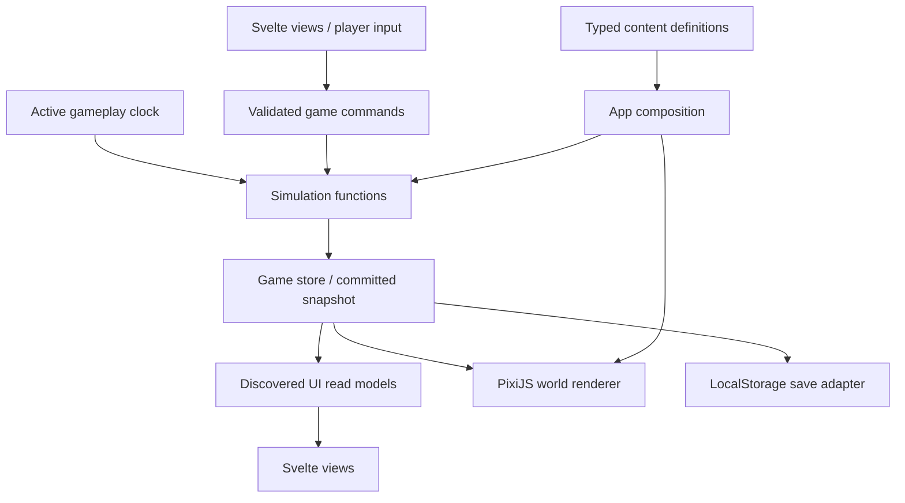

# VIBE CODER architecture

Status: proposed implementation architecture, revised for Svelte 5, PixiJS 8, mobile browsers, and development by agents. No game implementation exists yet.

Based on [the game specification](initial_design.md) and [the visual reference guidance](design_references/README.md). The specification defines the experience; this document defines how to build it. Numerical rules below are starting balance values, not claims that the game already meets its pacing targets.

The detailed execution order, TDD protocol, and per-task acceptance gates are in the [phased implementation plan](implementation_plan.md).

## 1. Shape of the application

Build one static browser application with three views, one simulation, and one save file. The main technical challenge is coordinating progression, cat care, narrative, and the expanding illustration within a short playthrough. Keep those rules visible in ordinary TypeScript functions and data.

| Concern | Choice | Reason |
| --- | --- | --- |
| Language/build | TypeScript, Vite | Small static build with a straightforward development workflow. |
| Interface | Svelte 5, plain CSS | Compact DOM views for controls, text, History, and Cat. |
| World | PixiJS 8 | Containers, sprite atlases, and animation without implementing a rendering framework. |
| Camera/transitions | Small TypeScript camera function; CSS for DOM transitions | Only authored position/zoom transitions are needed initially. |
| State | Framework-independent store with `subscribe` and `dispatch` | Svelte observes read-only snapshots; Pixi updates directly outside UI reactivity. |
| Persistence | Versioned JSON in LocalStorage | A bounded history and a few dozen milestones fit comfortably. |
| Deployment | Static hosting over HTTPS | No server, account system, or remote services. |
| Quality tooling | Strict TypeScript, ESLint, Svelte checks, Prettier, small local lint rules | Machine-enforced contracts keep agent changes predictable. |

Choose libraries by the application code they remove. PixiJS removes sprite/atlas/scene plumbing. Start without pixi-viewport, GSAP, a full game engine, a component library, a router, an entity/component framework, or a scripting language for rules. Add GSAP only if authored multi-step sequences become difficult to maintain; add a viewport library only if interactive camera navigation becomes a real requirement. Neither is needed for a single automatic camera transition. The game contains fictional agents and companies; no actual model calls, code execution, or repository integration are involved.



Only the simulation changes gameplay state. Rendering, animation completion, Svelte effects, and storage callbacks cannot award resources or decide cat death. The store and browser lifecycle wrapper coordinate calls; they do not contain game rules. One application runtime owns gameplay time. Pixi's ticker owns presentation only.

## 2. Module boundaries and layout

```text
src/
  main.ts
  app/
    App.svelte              # Exactly Game, History, Cat
    createGame.ts           # Compose catalog, simulation, store, adapters
    gameStore.ts            # Snapshot, dispatch, subscriptions
    runtime.ts              # Clock, lifecycle, simulation scheduling
  game/
    types.ts
    createRun.ts
    simulation.ts           # Ordered update of one simulation step
    commands.ts             # Player actions and validation
    economy.ts
    progression.ts
    cat.ts
    catPlay.ts
    narrative.ts            # Events, achievements, ending resolution
    selectors.ts            # What the current UI is allowed to show
    random.ts               # Small seeded PRNG
  content/
    balance.ts
    technologies.ts
    upgrades.ts
    events.ts
    achievements.ts
    endings.ts
    world.ts                # Authored positions, bounds, paths, art IDs
    assets.ts               # Sprite and illustration manifest
  ui/
    GameView.svelte
    HistoryView.svelte
    CatView.svelte
    Header.svelte
    SettingsMenu.svelte
    AudioControls.svelte
    CatPlay.svelte
    CatOverlay.svelte
    UnlockAnnouncement.svelte
    EndingPanel.svelte
    styles.css
  world/
    WorldCanvas.svelte      # Mount/resizing only; no per-sprite components
    renderer.ts             # Pixi application and incremental scene updates
    camera.ts
    sprites.ts
  persistence/
    save.ts
    migrations.ts
public/assets/
  sprites/
  technologies/
  memorial/
tools/
  eslint-rules/             # Local AST rules with valid/invalid fixtures
  validateContent.ts        # Catalog/asset consistency, not gameplay rules
AGENTS.md                   # Short project map and contribution contract
eslint.config.js
tsconfig.json
tsconfig.game.json          # Pure game/content check without DOM globals
```

These are file responsibilities, not a requirement to create empty scaffolding upfront. Keep adjacent functions together until splitting makes them easier to understand. Content is typed data with small predicate functions, not a plugin system. Use one package and one lockfile; this game does not need a monorepo.

Enforce these dependency directions, including re-exports and dynamic imports:

| Module | Allowed responsibilities and imports |
| --- | --- |
| `game/` | Domain types, rules, commands, selectors. Internal modules and pure utilities only; receives a typed catalog as an argument. |
| `content/` | Typed authored definitions. Type-only imports from game contracts; no runtime simulation or browser imports. |
| `ui/` | Svelte, public read models/command types, and small presentation helpers. No runtime catalog, persistence, simulation internals, or Pixi imports. |
| `world/` | Pixi and presentation helpers; receives scene definitions and a discovered-world projection. No persistence, economic rules, or command dispatch. |
| `persistence/` | Save types, validation, migration, storage adapter. No rendering or ticking. |
| `app/` | Composition, lifecycle, time, dispatch, view navigation, and adapter wiring. |

Put scene metadata used for rendering in the scene definitions passed by app composition. A small public contract module in `game/` is sufficient; add no general dependency-injection container. Svelte components receive a narrow public game API through props/context rather than importing a mutable singleton.

## 3. State and command contract

Keep three lifetimes distinct:

| Lifetime | Contains | Persistence |
| --- | --- | --- |
| Profile | Discovered endings and their first discovery order; theme and reduced motion preference | Survives a new run. |
| Run | Economy, milestones, choices, cat, timers, history, ending, random generator state | Resumes until deliberately restarted. |
| Presentation | Current view, camera interpolation, sprite frames, pointer state, current announcement animation | Reconstructed; reload opens Game. |

An illustrative state shape:

```ts
interface SaveData {
  schemaVersion: number;
  contentVersion: number;
  revision: number;
  profile: ProfileState;
  run: RunState;
}

interface RunState {
  id: string;
  status: 'playing' | 'ended';
  activeMs: number;
  needsElapsedMs: number;
  rng: { economy: number; cat: number; narrative: number };
  economy: EconomyState;
  unlockedTechnologyIds: TechnologyId[];
  upgradeLevels: Partial<Record<UpgradeId, number>>;
  completedMilestoneIds: string[];
  achievementIds: string[];
  choices: Partial<Record<ChoiceId, string>>;
  stats: RunStats;
  cat: CatState;
  catPlay: CatPlayState | null;
  history: HistoryEntry[];
  pendingUnlockIds: TechnologyId[];
  ending: { id: EndingId; catAlive: boolean; activeMs: number } | null;
}
```

`EconomyState` stores balances, capacity settings, and accumulated debt. `RunStats` stores lifetime output/revenue, meaningful manual actions, care counts, peak debt, time without oversight, and other explicitly needed ending facts. Spending output must not erase lifetime output milestones. Do not add statistics without a consumer.

`CatState` stores `health`, `mood`, `fullness`, `overfeeding`, `alive`, `diedAtActiveMs`, `lastPetAtActiveMs`, and relevant care/attention timers. Conditions such as hungry and sick are derived from these values. Active minigame state stores attempt number, target, speed, start time, result phase, and score.

Commands form a typed discriminated union, for example:

```ts
type GameCommand =
  | { type: 'primaryAction' }
  | { type: 'buyUpgrade'; id: UpgradeId }
  | { type: 'feedCat' }
  | { type: 'petCat' }
  | { type: 'startCatPlay' }
  | { type: 'catchMouse'; attemptId: number }
  | { type: 'leaveCatPlay' }
  | { type: 'choose'; id: ChoiceId; value: string }
  | { type: 'acknowledgeUnlock'; id: TechnologyId };
```

`dispatch` first advances the simulation to the input's active timestamp, validates the command against current state, applies it, resolves resulting discoveries/endings, then commits one snapshot. It serializes commands on the main thread. Buttons are advisory: the command handler also checks visibility, prerequisites, affordability, cooldowns, liveness, and run status. Return a typed result such as `applied`, `unaffordable`, `cooldown`, or `unavailable`; an expected rejection is not an exception. Double taps cannot purchase a one-time upgrade twice or score an attempt twice.

Use plain objects, arrays, and numbers. Copy only changed branches when publishing a snapshot; a general immutable-state framework is unnecessary. Keep simulation randomness seeded and persisted. Separate random streams prevent cosmetic animation or a changed joke schedule from changing food gains. Presentation randomness never consumes gameplay randomness.

The public store implements the Svelte subscription contract but is not writable by subscribers. Publish deeply read-only types; freeze snapshots in development to expose accidental nested mutation. Build compact `GameViewModel`, `CatViewModel`, `HistoryViewModel`, and `WorldViewModel` projections. Svelte sees meaningful state changes at at most the simulation rate; camera positions and sprite frames never enter its reactive store. Keep pointer movement and cosmetic animation out of persisted state.

Give cat updates a narrow signature: `updateCat(cat, elapsed, careInput)` returns cat state and cat events, without an economy argument. The simulation merges the result and records care statistics. This structural boundary prevents care logic from quietly becoming a productivity modifier; verify the overall invariant with a focused scenario as well.

## 4. Time, lifecycle, and update order

There is one definition of **active gameplay time**: the document is visible, the page has focus, the run is playing, and no explicit blocking pause is active. Reading History, visiting Cat, playing with the cat, and seeing a short unlock announcement all count as active play. Do not pause merely because the player stops clicking; watching automation and neglecting the cat are gameplay.

- Use `performance.now()` for elapsed time. Never derive needs or production from saved wall-clock timestamps.
- Schedule simulation at 10 Hz using one runtime timer. Pixi's application ticker is the only world drawing loop; do not add another `requestAnimationFrame` loop around it. The minigame samples the same active clock at input time, independent of the 10 Hz snapshot rate.
- Update production in 100 ms fixed steps. Cat needs accumulate elapsed active time and resolve every 5 seconds, as specified. Commands settle all elapsed eligible steps before applying their action.
- On `visibilitychange`, blur, `pagehide`, or freeze, settle eligible time, suspend the clock, and save. On resume, establish a new monotonic baseline; hidden time produces nothing and causes no decay.
- Treat a scheduling gap above 1 second as suspension and discard that gap instead of catching it up. Short gaps use bounded fixed steps. A device stall must not become several minutes of starvation.
- A new page load resumes from saved `activeMs`, never from `Date.now() - savedAt`. Wall-clock timestamps are optional metadata only.
- Endings freeze production, cat needs, and minigame input. Cosmetic animation may continue.

Use a simple set of pause reasons for startup/load, save recovery, restart confirmation, and fatal runtime errors. Pausing must apply to both economy and cat. Theme changes and foreground cat interruptions do not pause the simulation.

The runtime owns browser listeners and removes them on disposal. Visibility/focus handling must be idempotent across mobile app switching, screen locking, and back/forward restoration. Do not depend on `unload` to save. Normalize input timestamps at the browser boundary and clamp them to the current active interval; game functions receive active timestamps only. Svelte effects, Pixi shared tickers, and sprite completion callbacks cannot establish competing gameplay clocks.

For each fixed step, apply:

1. Active time and gameplay timers.
2. Production, costs, debt, and capacity constraints.
3. Due cat need ticks, health, and terminal death.
4. Progression and achievements from the resulting state.
5. Significant narrative events and ending resolution.
6. History and pending presentation events; publish a coherent snapshot.

This order makes an ending's cat variant unambiguous when starvation and the final milestone occur in the same step. A chosen ending also settles the cat before capturing its variant.

## 5. Economy and progression

### Keep the economy legible

Use the specified concepts with different roles rather than seven interchangeable currencies:

| Concept | Role |
| --- | --- |
| Output/code | Initial spendable balance; lifetime output also measures progress. |
| Tokens | Stock consumed by agent work; replenished by unlocked supply upgrades. |
| Agents | Owned capacity, increased by upgrades; not a currency. |
| Compute | Installed capacity limiting active work; not a continually drained second token bank. |
| Technical debt | Accumulated pressure reducing useful output; review/evaluation reduce it. |
| Automation | Derived fraction describing which manual responsibilities have been automated. |
| Revenue | Later spendable balance funding infrastructure and company decisions. |

Introduce each only when a current choice needs it. Display at most three relevant header statistics, with current costs on cards. Retire old statistics from the header without deleting their state. No dashboards or inventory pages.

Start with a compact throughput model:

```text
potentialWork = manualWork + agentCapacity × workPerAgent × elapsedSeconds
fundedWork = work allowed by available tokens and compute
usefulOutput = fundedWork × coordinationEfficiency × qualityEfficiency
debt += uncheckedWork × debtRate - reviewCapacity × elapsedSeconds
revenue += usefulOutput × monetizationRate
```

Here `manualWork` means work queued by accepted commands since the previous step, consumed once. At the company stage, subtract defined operating costs from revenue and track operating margin separately; persistent losses can enable the bankruptcy decision without allowing a negative spendable balance. Unfunded capacity idles rather than silently creating unlimited debt.

Manual work has a free fallback and needs no tokens. Coordination and quality efficiencies have positive floors. Review can reduce debt while generation is constrained. Running out of tokens or increasing debt slows the system; it must leave a recovery path. Balances stay nonnegative, all numbers finite, and rates are recomputed from purchased definitions rather than stacked mutable multipliers.

Keep numbers within ordinary finite JavaScript number ranges during a 30-minute run; use compact formatting. A big-number library and astronomical idle-game economy are unnecessary.

The primary action reflects the current responsibility: WRITE CODE supplies manual work, PROMPT supplies agent tasks, DELEGATE eases coordination, SUPERVISE clears a review bottleneck, and OPTIMIZE provides a bounded efficiency improvement. OBSERVE need not award output. Once an action is automated, passive rules take over its responsibility; replacing the label alone is insufficient. Each action's contribution has a cap/decay rule so rapid clicking cannot bypass the intended bottleneck.

### Technologies and upgrades

Use stable string IDs and a typed definition:

```ts
interface TechnologyDefinition {
  readonly id: TechnologyId;
  readonly prerequisites: readonly TechnologyId[];
  readonly canDiscover: (run: ReadonlyRun) => boolean;
  readonly title: string;
  readonly description: string;
  readonly illustrationId: string;
  readonly upgradeIds: readonly UpgradeId[];
  readonly primaryAction?: PrimaryActionId;
  readonly effects: readonly Effect[];
  readonly worldAdditionId: string;
}
```

An upgrade defines discovery requirements, costs, maximum level, effects, and explicit display priority. Keep `Effect` a small union for actual needs: rate/capacity changes, resource introduction, automation flags, and action changes. Complex special rules belong in named TypeScript functions. Do not build a generic expression interpreter.

`ReadonlyRun` is the deeply read-only run contract used by predicates/selectors, not a shallow `Readonly<RunState>` wrapper.

Distinguish **discovered** from **affordable**. A discovered current upgrade can show its price while disabled for insufficient funds. Future technology titles, art, counts, phase names, and locked achievements never enter rendered selectors or accessibility labels. Show a stable maximum of three currently relevant cards; required progression/recovery choices take precedence over optional repeatables. Bought one-time and obsolete cards leave the panel.

Plan 28 milestones, internally distributed as follows. This table is authoring guidance and never player UI:

| Internal phase | Milestones | Approximate active time on the main route |
| --- | --- | --- |
| Manual coding | Autocomplete; generated snippets; AI-native IDE | 0–4 min |
| Agentic coding | Terminal agent; autonomous edits; tool permissions; persistent instructions | 4–8 min |
| Orchestration | Ralph loop; reviewer; parallel agents; worktrees; manager agent | 8–13 min |
| Infrastructure | Context management; persistent memory; model routing; token optimization; local servers | 13–18 min |
| Recursive automation | Custom harness; meta-harness; evaluations; workflow optimization; self-improvement | 18–24 min |
| Autonomous organizations | Self-driving repositories; product management; marketing; finance; executive agents; autonomous company | 24–30 min |

Manual typing is the initial state, not an extra unlock. Testing arrives with the first autonomous edits and develops into later evaluation; it must not wait until recursive automation. Every milestone needs its own illustration, visible subsystem addition, and camera target. Small milestones can add small branches and zoom slightly; major ones reveal a larger surrounding layer.

The 16 reference cards are visual concepts, not the complete content catalog. Reuse their motifs, but budget for all 28 illustrations and matching world additions.

No hard timer forces a technology unlock. Tune prices, rates, and bottlenecks toward these windows; unlock conditions depend on actual play. Avoid passive chains granting many discoveries in a single frame: a newly discovered milestone's successor becomes eligible only after the current discovery is acknowledged. Queue acknowledgements without losing discoveries if the player switches to Cat.

### Unlock presentation

Commit the technology, effects, history entry, and pending announcement together. In Game, show an inline `NEW TECHNOLOGY` panel, illustration, name, and short description; slow only the world's cosmetic animation, reveal the subsystem, and interpolate the camera. Do not slow economic or cat time.

The panel occupies the world area; header navigation and care remain available. If Cat or History is open, defer its animation. Returning to Game plays pending reveals in order. Acknowledge on completed presentation or an intentional skip; reduced motion uses a brief static reveal. Reconstruct pending reveals after reload without reapplying costs/effects or duplicating History.

## 6. Cat simulation and care

### Overlapping conditions

Use `alive/dead` as the terminal lifecycle. Derive concurrent need/behavior conditions rather than forcing them into one mutually exclusive enum:

| Condition | Initial rule | Effect |
| --- | --- | --- |
| Normal | No adverse condition | Ordinary world behavior. |
| Hungry | Fullness < 35 | Hungry art/message; health eventually declines. |
| Lonely | Mood < 70 | Approaches programmer, meows, seeks attention. |
| Attention-seeking | Mood < 40 | Temporary foreground intrusions; stronger below 20. |
| Overfed | Overfeeding ≥ 40 | Rounder appearance, slower movement. |
| Sick | Overfeeding ≥ 80 | Lethargy, faster mood loss, recoverable health penalty. |
| Critical | Health < 20 | Weak behavior, contextual Cat screen text. |
| Dead | Starvation reduces health to zero | Permanent terminal state for this run. |

Presentation priority is dead, critical, sick, hungry, attention-seeking, lonely, normal, while independent body/need flags remain available. Centralize thresholds in balance data. No animation decides the condition.

### Starting balance

Start with health 100, mood 85, fullness 75, and overfeeding 0. Per 5 active seconds, subtract 0.65 fullness and 0.45 mood. Accumulate meaningful primary/upgrade actions into a capped needs modifier, applied on a needs tick: at most 10% extra decay per tick, no carryover. Navigation, care, theme changes, and minigame taps do not count. Clicking speed cannot multiply starvation without bound.

Starting health rules: lose 8 health/minute below fullness 20, increasing to 14/minute below 5; recover 4/minute above fullness 35 when not sick. Overfeeding decays by 6/minute. Sickness adds modest mood loss and may reduce health, but its health penalty has a floor of 10. **Only prolonged starvation can cause death.** Feeding stops starvation damage immediately by raising fullness; health returns gradually.

These rates give a useful calibration: a mean meal of 25 fullness covers about 3.2 minutes of base decay. The initial fullness provides several minutes of grace, and total neglect should kill well before a typical 30-minute ending. Validate those outcomes with the complete economy and care loop before finalizing values.

FEED grants a seeded random integer from 18 through 32, capped at fullness 100. Add excess-food pressure when pre-meal fullness is at least 85 or the meal substantially exceeds capacity. One excessive meal stays below the sickness threshold; repeated excess crosses it. Use a short eating lock to prevent duplicate touch events, and apply excess on every accepted meal rather than allowing a spam loophole.

PET grants +3 mood once per 60 active seconds. Further taps play a cosmetic response only. Use the low end of the specified reward range initially: +5 per minute almost cancels the base mood decay of 5.4/minute and risks making PLAY unnecessary. Tune mood/play together so PLAY remains useful around every 4–6 minutes for a cared-for cat.

Cat commands can change cat state, care statistics, and narrative records only. They cannot change production coefficients, token supply, prices, or automation. Time spent caring leaves passive production running and occupies the player's attention.

### Timing minigame

PLAY changes a substate of Cat, never opens another view. A session contains three attempts, each with a newly sampled target width of 15–30%, position, and bounded mouse speed. Use normalized track coordinates from 0 to 1; movement is a triangular wave based on elapsed active time. Rendering and hit detection call the same position function.

Each attempt includes a brief ready phase, a 4–5 second moving phase with repeated crossings, and a short result animation. One pointer or keyboard activation resolves it; timeout counts as a miss. Add target-crossing constraints when choosing speed so the narrowest target remains hittable on touch devices. Award +8 to +12 mood on a hit, +1 on a defined near miss, zero on a miss; clamp mood at 100. Three hits yield +24–36. Total session duration is roughly 10–20 seconds including animations.

Use `pointerdown` for touch timing and Space/Enter for keyboard. Evaluate input at its normalized monotonic event timestamp mapped into the active clock, not the last drawn frame. Track the attempt ID to reject repeated or stale input; use one activation path so a synthetic `click` cannot score again after `pointerdown`, and ignore keyboard auto-repeat. Mood gains commit per attempt; leaving a session ends the remaining attempts without a completion bonus. Reload resumes the saved session paused at the same active time. Backgrounding pauses it. Navigating away cancels it. Death cancels it permanently.

Measure fairness in milliseconds as well as track percentages: constrain speed so even the narrowest target has a starting hit window of at least 200 ms, then tune on real touch devices. Animate the DOM mouse from the shared active clock and transform only its position; resize changes track pixels, not normalized rules or the current score. Returning from background resumes the frozen attempt with a short visual ready cue before time continues for that attempt. Represent the cue as an explicit minigame phase and offset its movement origin by the cue duration; economy and needs resume normally. The cue introduces no extra care reward or independent clock.

### Foreground attention

The world cat and attention cat are separate render instances of one living cat, not separate gameplay entities. Pixi draws the former in world coordinates; Svelte draws the latter as an absolutely positioned DOM sprite over Game controls, using the same exported frames. A foreground Pixi container inside a canvas behind the DOM cannot cover HTML buttons. Keep only one WebGL canvas; Cat and its minigame use DOM/CSS animation and the shared atlas metadata.

Schedule bounded intrusions using active-time timers: below mood 40, occasional small obstructions; below 20, larger ones that can intercept the primary button. Each lasts a short maximum duration and has an interval before another. Only its visible footprint intercepts input; tapping it opens Cat. Keep the header, navigation, and unlock dismissal outside its blocking region. Do not show intrusions over History, Cat, or an ending. Low bars never become warning banners or enlarged panels.

### Death transaction

On starvation death, atomically set `alive = false`, record `diedAtActiveMs`, cancel play/attention state, append one History entry and the single log message “The cat is gone.”, and request an immediate save. All later care commands reject. No upgrade, ending, or load migration can revive it within that run.

Renderers immediately remove the world/foreground cat. The header uses a deceased icon and two empty gray bars. Cat becomes a memorial containing exactly two happy photographs: keyboard and lap. No status or care controls. Restarting deliberately creates a different run with a new cat; resuming cannot undo death through any supported game control.

## 7. World rendering and assets

### Scene composition and camera

Use one authored coordinate system with the original room centered at `(0, 0)`. Content definitions add clusters, connectors, and cat walk paths around it. Unlocks accumulate additions; do not replace the room with a different background or generate a geographic map. Pixi owns a stable root world container, with small nested containers for authored clusters. Hierarchy is a presentation tool: technology dependencies and cross-cluster connections remain separate graph data. A discovery does not have to reparent the entire existing world; preserve world transforms if reparenting is ever necessary.

Each addition specifies a stable ID, bounds, layer, authored sprite placements, connection endpoints, animation cues, and camera framing. Rebuild the scene from unlocked IDs on load. Save gameplay facts, not a duplicate scene graph or every particle position. Use a seeded visual pattern for repeating late-game machinery so reloads preserve the composition without saving thousands of entities.

For each milestone, author a monotonically expanding portrait framing envelope. Fit that envelope to the actual canvas area. The envelope grows even for a minor addition, ensuring each technological advancement shrinks the original room. Rotation/resizing refits the same envelope; it does not unlock content. Endgame framing deliberately puts the programmer below readable size.

Camera transformation is `screen = (world - cameraCenter) × zoom + viewportCenter`. Interpolate position and zoom over about 1–2 seconds with one named easing function; reduced motion jumps to the target. Apply the result to the root container. Bound the camera so the room remains within the conceptual composition. No free camera controls or pixi-viewport dependency are needed for the first version.

Use nearest-neighbor texture sampling, integer atlas rectangles, and consistent pixel alignment. Start with Pixi resolution capped at device pixel ratio 2 and lower it if the frame budget requires it. CSS `image-rendering: pixelated` applies to DOM sprite assets but does not replace texture sampling settings. Smooth fractional zoom can produce some pixel stepping; preserve recognizable pixel forms rather than promising perfect integer scaling throughout a continuous zoom.

### A small amount of LOD

Choose level of detail from an object's projected CSS-pixel size, consistently across device pixel ratios. Start with three representations for large clusters: detailed composition, compact motif, and a few pixels. Use small hysteresis bands to avoid switching representations back and forth at a threshold. Add special intermediate artwork only when a transition looks poor; do not create a seven-level LOD framework for every entity.

At early scales, draw the cat normally. As projected size falls, reduce detail to an orange cluster, then a single screen pixel. At the final framing, stop drawing that pixel even if the cat is alive; visual disappearance does not change its state. A dead cat is absent at every scale. Foreground attention remains readable at any world zoom while the run is playing.

Use Pixi `AnimatedSprite` for typing and cat frame animations, with small numeric updates for terminal pulses, data packets, and walks. Drive animated sprites from the owned presentation ticker rather than an uncoordinated shared ticker. Cat paths become available with their supporting structures. Interpolate cat movement locally; exact cosmetic position need not survive reload. For the large final network, draw repeated motifs and a limited set of animated signals, not one simulated agent per displayed node.

Cache only bounded static clusters when measurement justifies it, and invalidate them on relevant unlock/theme changes. Never rasterize the entire expanding world into one enormous render texture: texture size and GPU memory would grow with world coordinates. Cull offscreen clusters and switch distant clusters to simplified sprites. Graphics paths are created on scene changes, not rebuilt each frame. Moving signals reuse sprites; avoid filters, per-frame allocations, and unbounded particles initially.

Start with a 30 fps world target on mobile; allow 60 only if measured devices sustain it comfortably. Input and the minigame timing do not depend on world fps. Stop the Pixi ticker when Game is not visible or the page is suspended. Keep its application alive across view switches, resume from current state, and destroy it only when the application is disposed. Svelte mounts the canvas host once, attaches a `ResizeObserver`, and disposes listeners/resources explicitly. No per-sprite Svelte components or extra framework-to-Pixi binding package are needed.

### Mobile delivery and asset production

The asset manifest maps stable IDs to source rectangles, animation frames/durations, animation tags, palettes, and semantic roles. Keep editable art sources and export commands documented. Aseprite batch export is appropriate if available; LibreSprite/Piskel or another export path can provide the same PNG/JSON contract. A proprietary editor must not be required to run the checked-in game. Verify atlas format with a small import adapter; an editor's JSON is not automatically identical to Pixi's spritesheet schema.

Deliver room/programmer sprites, infrastructure motifs, world and foreground cat states, 28 technology illustrations, UI icons, and the two memorial photographs. Build world additions from a reusable kit of terminals, servers, robots, connectors, frames, and indicators. Keep each discovery illustration distinctive, with shared motifs; do not draw 28 complete world backgrounds. Exported sprites and atlas metadata are generated artifacts, not files to edit independently.

Preload essential room/cat/header assets; load the Pixi module after the DOM shell and defer later illustration packs. Keep startup paused until a minimal playable scene is ready. Preload only the next relevant pack silently without exposing future names; a downloaded asset is not a discovered technology. Load full-size announcement art on demand and release unused GPU textures at pack boundaries. Avoid forced eviction/reload on every view switch. Use palette variants for light/dark; theme never depends on progression. Reserve image sizes and provide a simple pixel-art fallback for a missing illustration so it cannot block play.

Use these initial engineering budgets, measured on a production build and revised from device evidence:

| Item | Starting target |
| --- | --- |
| Initial JavaScript, including the first Pixi chunk | At most 350 KiB gzip, excluding later art; use actual bundled imports rather than assuming tree shaking. |
| First playable asset transfer | At most 1 MiB; later packs are deferred. |
| Whole-session raster art transfer | Aim below 8 MiB, with reuse and compressed PNG/WebP where pixel quality permits. |
| Atlas dimensions | Prefer at most 2048×2048; account for decoded RGBA bytes, not PNG file size. |
| Resident texture/render-target memory | Aim below 64 MiB; a single 2048² RGBA texture already uses about 16 MiB before mipmaps/copies. |
| World frame work | Target below 16 ms at the 95th percentile on the chosen mid-range reference phone, while presenting at 30 fps. |

These are tuning budgets, not proven measurements or reasons to add an optimization framework. Measure a late-game scene early, together with theme changes and repeated Game/Cat navigation. Prefer fewer textures, simpler distant detail, and lower render resolution before introducing workers or another renderer. Leave rendering off the gameplay critical path.

On graphics-context loss, pause presentation and rebuild the scene from the current unlocked IDs after restoration; never reset the run or infer a cat outcome from missing sprites. If recovery fails, pause gameplay and offer a retry. Static hosting must serve fingerprinted build assets with long caching and fresh HTML; avoid a service worker in the first version so updates do not introduce a second save/content compatibility problem.

The supplied PNG references are composition guides, not production sprite sheets. In particular, ignore their enlarged cat indicators, automatic-looking theme progression, extra labels, and memorial layout where those conflict with the specification.

## 8. The three views and responsive interface

`App` holds a `game | history | cat` view choice; no routing library or additional route is needed. Opening another view swaps the content immediately without creating a new run or clock. Support browser Back by mapping view changes to same-page history entries. Returning from either secondary view shows Game; a second Back behaves normally.

**Game:** persistent header, flexible world region, compact control region. Begin around the specified 12/53/35 proportions, but use CSS grid with content-sized header/controls and a `minmax(0, 1fr)` world. Use `100dvh` with a `100vh` fallback and safe-area padding. On short screens reduce world height, typography spacing, visible log lines, and optional cards before allowing minimal scroll. Avoid fixed proportions that clip the primary button. Use a viewport meta tag without disabling user zoom. Target 320×568 through contemporary portrait phones; landscape can use a compact variant. Browser toolbar changes and orientation must resize presentation without resetting a minigame, production, or camera progression.

**Header:** CAT immediately beside HISTORY, a Settings button, and up to three current statistics. Settings contains the theme control, a sound on/off switch, and a Music submenu with volume/audio controls and a Music Lab link. The submenu and settings are panels within the current view. The CAT hit area is at least 44×44 CSS px. Inside it, two tracks sit directly below the icon button, each exactly constrained by the button's width, 3–4 CSS px tall, with 2–3 px gaps. They show health and mood; fullness appears in Cat only. Add accessible names without permanent visible labels or percentages. Do not continually announce numeric changes to assistive technology.

**Controls:** one primary action, at most three current upgrade/choice cards, and a short recent-event log. Upgrades and ending decisions use this same surface. The unlock panel stays in the world region. Focus remains predictable when a card disappears or a presentation finishes.

**History:** chronological discovered technologies, achievements, significant events, and cat moments for the current run, plus previously discovered endings from the profile, carrying their run/discovery timestamps. Show only actual entries. This view can scroll; do not retain every routine click or repetitive flavor line.

**Cat:** large animated illustration, detailed physical status/mood/fullness, condition text, FEED/PLAY/PET. PLAY replaces part of this view with its track and results. After death replace the interactive content with the two-photo memorial. Secondary views have an immediate return control.

**Ending:** an inline state of Game in the world/control area, not a fourth screen. Show the selected text and discovered ending, and offer a new run there. Keep History and Cat accessible with simulation frozen. New-run confirmation is inline; it explains that the current run is replaced and discoveries are retained.

Use semantic buttons, keyboard focus, readable text, non-color distinctions for cat bars, and touch-sized controls. Honor `prefers-reduced-motion` with a manual preference if needed. Keep decorative pixel fonts to headings/buttons where readability allows. The world canvas is decorative with a concise accessible description of the current discovered scene; gameplay information stays in DOM text. Avoid an automatic screen-reader stream of jokes and state changes.

Use Pointer Events and `touch-action: manipulation` on buttons. Disable touch scrolling only on a surface that genuinely captures a gesture; History must retain normal scrolling. Do not require hover, drag, audio, or haptics to complete a run. Retain browser accessibility gestures. Touch timing and readability must be assessed on actual iOS Safari and Android Chrome; desktop emulation alone is insufficient.

## 9. Narrative, achievements, and endings

Events have IDs, predicates, phase/tone eligibility, once-per-run flags or cooldowns, and text. Evaluate a small ordered list after updates; this volume needs no event bus. Distinguish durable significant History entries from bounded recent flavor logs. Give death and major discoveries priority over ambient jokes so a generic message cannot overwrite them in the same update.

Achievements are discovered records only: no locked grid, progress counter revealing a total, or productivity bonus for care. Cat survival/death can affect narrative achievements and ending variants without entering production formulas.

Endings use explicit predicates, optional player decisions, text variants, and priorities. Make most consequential endings deliberate choices when a relevant situation arises; do not let a threshold unexpectedly terminate a run before a competing branch can be chosen. Offers appear among current cards, respect the three-card limit, and become available through their own evidence. No hidden ending may depend on an unreachable combination of mutually exclusive choices.

The following initial branches make at least ten distinct endings implementable. Their detailed costs/thresholds belong in content:

| Ending | Concrete route / resolution trigger |
| --- | --- |
| Fully Automated Bankruptcy | Automated company has persistent operating losses; choose to continue unfunded expansion after a visible loss warning. |
| The Greenest Pipeline | At late evaluation maturity, choose to freeze feature work and preserve a fully passing pipeline. |
| The Great Merge Conflict | Parallel-work debt crosses a high threshold; choose an attempted merge instead of stabilization. |
| Acquired by Yourself | Unlock corporate finance; accept a self-acquisition offer. |
| The Perfect SaaS | Reach sustainable product revenue and low debt; choose to keep a small profitable service. |
| Enterprise Transformation | Accept the late enterprise contract and its process requirements. |
| The Last Programmer | At an orchestration branch, reject further automation and finish with sustained manual contribution. |
| Three Users | After the original project becomes shippable, choose to ship it modestly rather than expand infrastructure. |
| The Forgotten Project | Prioritize harness work repeatedly; choose to archive the still-unshipped original project. |
| The Infinite Weekend | Reach recursive workflow optimization; choose to keep polishing the harness indefinitely. |
| You Have Been Optimized | Reach autonomous company operation and accept removal of human oversight. |
| The Human Approval API | Retain mandatory human approval at the final organizational decision. |
| Alignment Achieved | At mature evaluations, choose to lock the objective and accept its literal outcome. |
| Recursive Succession | Permit the self-improving harness to replace its own supervisor. |
| The Closed Loop | Close all external product/customer feedback paths after autonomous operations unlock. |
| The Last Real Message | At the final stage, choose to send a personal message rather than another work instruction. |
| Just Three Buttons | Secret route: once shipping is possible, a sustained interval containing only FEED/PLAY/PET makes a quiet “stay here” choice available. |

Implement ten fully distinct, reachable routes before expanding to all seventeen. Define the exact secret interval and non-care exclusions as named balance/content rules; screen navigation is not a disqualifying action. Never reward rapid pet spam. Care-focused branches can end a run narratively but grant no production advantage.

All branch choices need honest local wording, with confirmation for destructive commitments, without naming undiscovered endings. Each route must have a documented prerequisite sequence and feasible economy values during implementation. A branch that retains manual work explicitly keeps the corresponding action available; it cannot depend on a control already retired by automation. Early shipping/manual endings may be shorter; roughly 30 minutes targets the complete automation route.

Ending selection is atomic and idempotent. Set the run to ended, capture the cat's current fate, append History, add a unique profile discovery, and save. Store narrative text IDs/variant facts rather than recomputing the outcome from a later run. Use explicit priorities only for simultaneously satisfied automatic outcomes; do not depend on definition-array order. Always retain a standard final automation resolution so unusual play cannot get stuck without an ending.

## 10. Persistence and recovery

Use one LocalStorage envelope containing profile and run so discovering an ending or restarting cannot save only half the change. Save every 5 active seconds while dirty, on lifecycle suspension, and immediately after purchases, discoveries, ending choices, cat care results, death, and restart. Coalesce ordinary primary clicks into the periodic save. Keep the envelope small: bounded ambient log, milestone-scale History, no frame data or action replay.

Load with structural validation and explicit migrations. Reject nonfinite balances, invalid ranges, broken ID references, impossible live/death combinations, and unsupported future schema versions. Keep a content version alongside the schema version; rename content IDs with explicit mappings rather than silently dropping progress.

`localStorage.setItem` atomically replaces the envelope. Do not automatically fall back to an older run after a failed read: that can resurrect the cat or erase an ending. Preserve unreadable data, pause, and offer retry or an explicit new run while retaining any independently recoverable profile facts. Starting over is a player decision, never an invisible recovery policy.

On a write/quota failure, retain the in-memory run and show a compact “Progress could not be saved” message with retry. If persistence is unavailable from startup, explain once that this session cannot resume; play can continue. Irreversibility applies to supported game behavior; a local-only game cannot prevent storage editing or guarantee writes when the browser refuses storage.

Support one playing tab per save. Use a browser Web Lock for ownership where available; a second tab waits with simulation paused. On browsers without that API, compare the loaded revision before saving and listen for `storage` changes; pause on an external write instead of merging runs. This fallback cannot exclude simultaneous writes, so treat multiple playing tabs as unsupported there. Do not build a synchronization protocol for this game. New run preserves the profile inside the same envelope and increments the revision.

## 11. TypeScript and development by agents

This section specifies executable tooling and the contribution contract to establish with the first code scaffold. The current repository still contains design documents only; names below are intended project files/commands, not claims that those checks already exist.

### Type contracts before abstraction

Use a supported Node LTS release, npm, one committed lockfile, and `npm ci` for reproducible installs. Record the Node major in the repository and pin resolved dependencies through the lockfile. Use Svelte 5's supported Vite plugin, `svelte-check`, ESLint's flat configuration with TypeScript/Svelte parsers, and Prettier with Svelte support. Formatting belongs to Prettier; ESLint enforces correctness and boundaries. Avoid competing formatters and duplicate rules.

Enable `strict`, `noUncheckedIndexedAccess`, `exactOptionalPropertyTypes`, `noImplicitOverride`, `noFallthroughCasesInSwitch`, `noUnusedLocals`, `noUnusedParameters`, and `verbatimModuleSyntax`. Use bundler-compatible ES modules and TypeScript's normal Vite/Svelte configuration. Run a second `tsconfig.game.json` check over `game/` and pure content with an ES library and **no DOM or ambient Node types**. Simulation code must not compile merely because the UI has browser globals available.

- Use discriminated unions for commands, effects, cat-play phases, and command outcomes. Exhaustively check switches with an `assertNever` helper. Avoid loosely related boolean flags when a union represents mutually exclusive phases.
- Author catalogs with `as const satisfies ...`; derive literal IDs from small ID tuples in the domain contracts so game types do not need to import content implementations. Use explicit types for public contracts and inference for local variables. Validate external IDs before converting them to catalog IDs.
- Use `unknown` for storage/external input, narrow it at the boundary, and check numerical ranges as well as types. A type assertion cannot validate saved JSON. Keep runtime save validation in one place; introduce a schema library only if maintaining a small validator becomes harder than the dependency.
- Enable type-aware rules for unsafe `any` operations, floating promises, misused promises, and nonexhaustive switches. Disallow explicit `any`, non-null assertions, and `@ts-ignore` in authored source. Prefer guards to unsafe casts; legitimate boundary assertions must be localized and explained.
- Document units on balance fields (`Ms`, `PerSecond`, `PerNeedsTick`) and keep conversions at named boundaries. Do not build a branded-units framework unless unit mistakes actually recur.
- Keep mutable construction details private. Store subscribers, predicates, and renderers receive read-only contracts. Use explicit return values for domain events rather than a global event bus.

### A few custom lints with concrete purpose

Start with standard compiler/ESLint capabilities, especially restricted imports/globals. Implement a local AST rule only where those cannot express the contract. Keep rules in `tools/eslint-rules/`, load them directly from the ESLint config, and cover each custom rule with small valid/invalid fixtures. No separately published plugin package, regex scans of source code, or lint framework is needed.

| Check | Enforcement and intended failure |
| --- | --- |
| `vibe/layer-imports` | Resolve imports, re-exports, and static dynamic-import targets against the dependency table in section 2; reject disallowed paths even through aliases. Prevent a component importing command handlers, or game rules importing Pixi. |
| `vibe/no-ambient-game-time` | In `game/` and pure `content/`, reject wall-clock/random/browser timing access (`Date`, `performance`, `Math.random`, `crypto`, timer APIs). Elapsed time and seeded randomness arrive through explicit arguments/state. Standard restricted-global rules can implement most of this. |
| `vibe/no-raw-content-in-ui` | Reject runtime catalog/asset-manifest imports in `ui/`, including through barrels. Views consume discovered read models and selected sprite metadata. This closes the obvious future-technology leak; it does not claim to prove all information-flow properties. |
| `vibe/owned-scheduling` | Allow gameplay interval/timeout creation only in `app/runtime.ts`. Presentation scheduling uses the renderer's owned ticker or a named disposable DOM animation helper; UI event handlers cannot start another economy/cat timer. Use an explicit small allowlist. |

Deep read-only types and the store API enforce state ownership; do not write a custom rule pretending to infer every mutation or economic consequence. Similarly, verify care/production independence and hidden-progression behavior with focused behavioral scenarios, not source-pattern guesses. Some rules intentionally overlap at important boundaries; emit one actionable diagnostic rather than several duplicates.

Each diagnostic states the forbidden dependency/API and its permitted replacement. A rule or type failure is fixed at the responsible boundary. Avoid blanket disables, `as unknown as ...`, growing exception lists, or changing fixtures merely to obtain a green check. A necessary narrow exception includes its reason; update the architectural contract when the rule itself was wrong.

### Content checks and development commands

`validateContent.ts` checks duplicate IDs, broken prerequisites, cycles in required progression, invalid costs/ranges, unknown effect/action IDs, and missing illustrations/world additions/animation tags. Validate authored camera envelopes and LOD thresholds too. Check that each declared ending has a route/scenario reference. This catches broken definitions, but arbitrary predicates and balanced ending reachability still require running scenarios. Do not claim a graph validator proves a 30-minute playthrough.

Establish a short command interface when implementation begins:

| Command | Responsibility |
| --- | --- |
| `npm run dev` | Start Vite. |
| `npm run check:types` | Svelte/TypeScript checks, including the pure-game configuration. |
| `npm run lint` | Standard and local AST rules; zero warnings. |
| `npm run check:content` | Catalog and exported asset consistency. |
| `npm run format:check` | Check formatting without rewriting files. |
| `npm run check` | Aggregate the preceding static checks; no hidden file mutation. |
| `npm run build` | Production bundle and asset output; report compressed bundle sizes. |
| `npm run test:rules` | Valid/invalid cases for local lint rules. |
| `npm run test:game` | Focused deterministic invariants and ending/care scenarios. |
| `npm run test:browser` | Small set of mobile viewport/input/lifecycle acceptance flows. |

Add test commands with the behavior they exercise, rather than empty scaffolds or coverage targets. Vitest is suitable for meaningful pure-game checks and ESLint rule fixtures; Playwright for the few browser flows that need DOM/input/lifecycle coverage. A normal code change runs static checks, a production build, and checks relevant to the changed behavior. Reuse existing successful results when no new change affects them. A documentation-only edit needs document review, not a browser suite. CI runs the same commands and uses `npm ci`; no separate CI-only implementation of checks.

### Keep agent tasks small and reviewable

Create a short root `AGENTS.md` with the module map, exact commands, design constraints, and links to this document. Keep one source of truth per rule; do not copy the design into every directory. Explain which files are authored versus generated. Future agents should be able to find the correct entry point with a targeted search.

For a code task, state the observable outcome, affected boundary, acceptance conditions, and explicitly relevant checks. Prefer a vertical slice such as “buy the first agent, persist it, render its node” over building a general engine before gameplay. Change a public type and its callers together. Use the smallest fixture that represents the real failure; avoid tests that merely repeat implementation arithmetic or require snapshot regeneration for every joke.

Content additions should normally touch a definition, assets, and a route/scenario when behavior changes; they should not require another central switch for every technology. A new effect kind is an explicit contract change with exhaustive handling. Keep expected rejection reasons observable in development without noisy production logs or debug controls in the player interface.

Before editing, inspect repository status and relevant instructions. Preserve concurrent/unrelated changes, stage exact task files, and report what was actually checked. Keep dependency upgrades, catalog rewrites, formatting sweeps, and save migrations out of unrelated feature patches. Do not introduce delegation infrastructure; when parallel work is explicitly requested, divide by owned files/contracts and integrate against the same checks.

## 12. Implementation sequence

Each slice should produce something playable or reviewable before adding breadth.

1. **Playable foundation:** Vite/Svelte/TypeScript/PixiJS, strict configs, initial boundary lints, documented commands, three views, theme, store/runtime, manual output, first three technologies, versioned save/resume, room sprites. Establish active-time suspension before adding health loss; measure one representative late-world composition before producing all art.
2. **Complete cat loop:** needs, tiny header bars, FEED/PET, three-attempt PLAY, attention overlays, starvation/death, memorial, reload behavior. Verify care and background behavior while the economy is still simple.
3. **Progression slice:** implement one full bottleneck transition from manual work through agents, review, and coordination; connect typed definitions, unlock artwork, persistent scene additions, and camera motion. Tune this slice before copying its pattern.
4. **Full automation route:** author all 28 milestones and their illustrations/world additions, remaining resource introductions, evolving primary actions, theme assets, and narrative. Tune the main route toward 30 active minutes including care interruptions.
5. **Branching completion:** implement ten reachable endings and cat variants, retained discoveries, restart, and later expand to seventeen. Add achievements and remaining flavor where they support the experience.
6. **Mobile finish:** portrait fit, real iOS/Android touch timing and lifecycle, readable controls, reduced motion, late-world performance/memory, save/context recovery, and final art consistency. Treat these as completion work rather than optional polish; mobile checks also accompany the preceding slices.

## 13. Validation plan and tuning risks

This is a plan for implementation validation; no runtime checks or playtests have been performed for this document.

Keep future automated checks focused on meaningful game invariants: inactive time cannot change needs or production; invalid purchases cannot spend; care cannot improve production; death remains dead across resume; one attempt cannot score twice; unlock/ending events commit once; restart retains discoveries; every ending has a feasible route; migrations preserve terminal facts. Seeded simulation functions make these checks possible without browser rendering.

During implementation, use accelerated deterministic runs to explore economy stalls and care policies: no care, regular feed/play/pet, overfeeding, pet-only, slow clicking, and long Cat/History visits. These checks establish reachability and timing bounds, not whether the experience feels good. Human mobile playthroughs must establish the 30-minute pace, usefulness of PLAY every 4–6 minutes, fair timing windows, emotional restraint, and actual control fit. Explicitly exercise background/foreground, screen lock, back/forward restoration, toolbar/orientation resizing, reload during play/reveals, death near an ending, two tabs, unavailable storage, and graphics-context restoration. Record the phone/browser and measured build; emulation is useful coverage but not proof of device performance.

The largest uncertainties are content pacing, the amount of original pixel art, and minigame fairness on real phones. Keep their rates, thresholds, timing windows, and compositions in editable data. Do not solve them with a more elaborate engine. Ship the smallest complete version of the specified experience: three views, a coherent automation arc, a genuinely independent cat, and meaningful endings.

## 14. Music subsystem

The [sound architecture](sound_architecture.md) extends this design with Tone.js playback, JSON compositions, Tonal-based validation, and a Svelte developer Music Lab. It follows the [sound specification](sound_design.md). Music is presentation: it receives committed technology/lifecycle projections through app composition, uses an independent musical transport, and cannot mutate gameplay or consume gameplay randomness.

The three-view rule applies to the incremental game. Settings and its Music submenu are local panels, and **Settings → Music → Music Lab** opens a separate workbench entry at `/music-lab/`, included in the normal production build by the user's explicit decision. Its code loads on navigation and does not run a game simulation. Audio failures never block gameplay. Cat needs and death do not alter the soundtrack. Only explicitly allowed care actions may emit occasional SFX. Extend boundary lints for the audio adapter; do not grant DOM/Tone access to the pure game modules. Audio preferences and Lab reviews/imports have separate storage keys so the workbench cannot overwrite a run.
