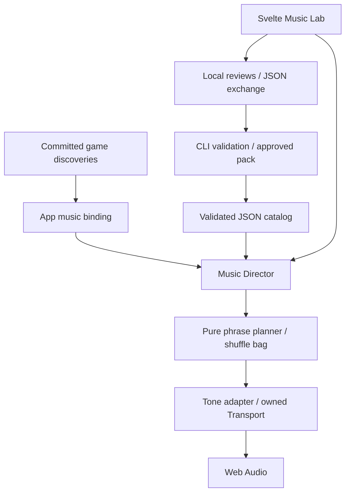

# VIBE CODER — архитектура музыки и Music Lab

Статус: архитектурное решение для будущей реализации. Аудиодвижок, Lab и музыкальные данные пока не реализованы. Численные бюджеты ниже — стартовые цели, не результаты измерений.

Основание: [музыкальное ТЗ](sound_design.md), [архитектура игры](architecture.md), [основной TDD-план](implementation_plan.md). Здесь проектируется музыкальная инфраструктура и четыре временных демо, а не финальный саундтрек из 60 паттернов. Главный мотив и окончательные композиции утверждаются человеком позже.

Порядок небольших TDD-задач и выходные проверки: [план реализации музыки](sound_implementation_plan.md).

## 1. Решение и границы

Один клиентский музыкальный движок на **TypeScript + Tone.js**, музыкальные правила/проверки через **Tonal.js**, произведения и настройки — JSON. **Svelte 5** используется для Music Lab и аудиоконтролов. Vite, npm, TypeScript, ESLint и тестовые инструменты общие с игрой. Backend, аудиогенеративный API, второй игровой движок и редактор партитур не нужны.

| Часть | Ответственность |
| --- | --- |
| Музыкальные данные | Ноты/ударные, harmony, границы фразы, era, presets, arrangement, motif |
| Чистое музыкальное ядро | Валидация, шаги/ticks, совместимость, shuffle-bag, план следующей фразы |
| Music Director | Текущая/запрошенная era и arrangement, очередь перехода, lifecycle intent |
| Tone adapter | AudioContext, инструменты, музыкальное расписание, voice limits, mix/dispose |
| Game binding | Преобразование уже открытых технологий в музыкальную проекцию |
| Music Lab | Прослушивание, сравнение версий, review, import/export, feedback prompts |
| CLI/build tools | Проверка JSON, поиск сходства, сборка approved pack и prompt generation |



Ни аудио, ни review не меняют экономику, active time, seed игры или судьбу кота. Игра полностью проходима без звука. Ошибка AudioContext/данных не блокирует игровую симуляцию и не вызывает restart.

## 2. Файлы и зависимости

```text
src/music/
  core/
    types.ts                 # Контракты без Tone/DOM
    timing.ts                # Musical steps -> ticks, интервалы нот
    shuffleBag.ts
    compatibility.ts
    phrasePlanner.ts
    validation.ts            # Semantic diagnostics; Tonal в validator path
  data/
    patterns.generated.ts    # Типы, полученные из JSON Schema
    loadCatalog.ts            # Проверенные JSON -> immutable catalog
  director.ts
  backend/
    toneBackend.ts           # Единственная точка обращения к Tone
    instruments.ts
  public.ts                  # Узкий public API, без mutable state
src/app/
  musicBinding.ts            # Game projection -> director; audio lifecycle
src/ui/
  SettingsMenu.svelte        # Звук и вход в подменю «Музыка»
  AudioControls.svelte       # Аудиоконтролы внутри settings/submenu
src/music-lab/
  main.ts
  App.svelte
  components/
  reviewStore.ts
  feedback.ts
  previewTimeline.ts
music-lab/index.html          # Второй HTML entry обычной production-сборки
music/
  README.md
  COMPOSITION_GUIDE.md
  PATTERN_SCHEMA.json
  schemas/                   # Era/preset/motif/review документы
  motif/demo-main.json
  eras/                      # Шесть музыкальных эр
  presets/
  arrangements/
  patterns/<era>/<id>.v<revision>.json
  reviews/                   # Экспортированные review documents
  composer-prompts/lead-composer.md
  composer-prompts/era-composer.md
tools/music/
  validate.ts
  buildPack.ts
  generateTypes.ts
  generatePrompt.ts
tests/music/                 # Scenarios, schema fixtures, audio render tests
tests/browser/music-*.spec.ts
```

Создавать файлы по мере появления поведения. Каталог из шести эр и четырёх демо мал; отдельные packages/workspaces, plugin registry и service container излишни.

- `game/` и `content/` игры ничего не импортируют из music, Tone или Lab.
- `music/core/` не импортирует browser APIs, Svelte, Tone, game state или storage. Seed передаётся явно; RNG музыки отдельный от gameplay RNG.
- `director` использует чистые контракты и небольшой внедряемый scheduler/backend. Конкретный Tone adapter подключает app composition.
- Только `backend/` импортирует Tone и управляет его Transport/nodes. Одновременно существует один владелец аудиотранспорта в документе.
- Game UI использует public audio API; не импортирует raw patterns, Tone или reviewStore. Music Lab включён в production отдельным entry, но не входит в граф зависимостей первого игрового экрана.
- Lab использует тот же director/player/selector, а не отдельную демонстрационную реализацию проигрывания.
- CLI работает с теми же схемами/семантическими проверками; Node filesystem не попадает в browser bundle.

Чистый `tsconfig.music.json` исключает DOM/Node globals и tests, как `tsconfig.game.json` для основной игры. Не расширять разрешения чистой симуляции ради AudioContext.

## 3. Данные, версии и валидация

### Один источник типов

Канонический pattern contract — локальная **JSON Schema** с `schemaVersion: 1`, запретом неизвестных полей и явными `$defs` для note/drum events. Использовать Ajv с поддержкой выбранного draft для runtime/CLI структурной проверки; все schema references локальные. TS-типы получать воспроизводимым dev-generation из схемы, а не поддерживать второе расходящееся описание вручную. Сгенерированные types не редактируются; CI проверяет соответствие без изменения файлов.

Ajv и Tonal нужны в CLI/Lab/загрузке музыкальных данных, не в 10 Hz игровом tick. Подключать их лениво вместе с музыкальной функциональностью. Игровой каталог формируется из уже проверенных pack records, но внешняя JSON-загрузка всё равно проходит проверку перед проигрыванием.

Пример содержимого, не полная схема:

```ts
interface PatternDocument {
  schemaVersion: 1;
  id: string;
  revision: number;
  eraId: string;
  bars: number;
  stepsPerBar: number;
  timeSignature: [number, number];
  bpm?: number;
  key: { tonic: string; mode: string };
  harmony: { step: number; length: number; chord: string }[];
  energy: number;                         // 0..1
  tracks: Record<string, MusicalEvent[]>; // Семантические роли
  boundary: {
    entryGroup: string;
    exitGroup: string;
  };
  motifRef: { id: string; revision: number };
  license: 'CC0-1.0' | 'CC-BY-4.0';
  attribution?: string;
  demo: boolean;
  metadata?: { description?: string; composer?: string };
}

type MusicalEvent =
  | { type: 'note'; step: number; length: number;
      pitch: string; velocity?: number }
  | { type: 'drum'; step: number; length: number;
      sound: 'kick' | 'snare' | 'hat'; velocity?: number };
```

Роли — lead/bass/arp/percussion и позднее явно добавленные роли, не имена Tone classes. Era/arrangement сопоставляют role с preset ID. Пауза — отсутствие события; не нужны специальные ноты `REST`. Для аккорда несколько note events начинаются на одном step. Sustain/drone выражается длительностью, а не бесконечно звучащим отдельным режимом.

`step` и `length` — целые элементы выбранной сетки, `length>0`; события занимают полуинтервалы `[step, step+length)`. Конец ноты может совпадать с концом паттерна, но не пересекать его. Release tail задаётся bounded preset envelope, не неявным tie. Velocity default0,8, диапазон0..1; ноль не создаёт голос. Future MIDI import/export переводит эти события и metadata; `@tonejs/midi` пока не требуется.

Tempo/meter/grid берутся из pattern override либо era defaults по однозначным правилам. Meter и grid обязательны в нормализованном каталоге; bpm override допускается только в совместимой clock group или как явный tempo change на boundary. Нельзя незаметно проиграть 90 BPM pattern как 120 BPM.

### Три уровня диагностики

| Уровень | Примеры | Последствие |
| --- | --- | --- |
| Hard error | Неверная схема/нота/era/role, события вне bounds, нулевые durations, непредставимые ticks, превышение допустимого pitch/polyphony, нет attribution для CC BY | Pattern не проигрывается/не входит в pack |
| Musical warning | Non-chord tone, спорное voice leading, near duplicate, высокая плотность, неубедительный cadence | Человек слушает и решает |
| Human review | Качество мотива, убедительность стиля, гладкость последовательности и переходов | Только человек даёт approved |

Tonal нормализует pitch/chord/scale и помогает анализу; принадлежность тональности не доказывает совместимость. Валидатор не объявляет мелодию хорошей. Intentional chromaticism — warning с пояснением, а не причина автоматически запрещать Self-Improvement.

Polyphony проверяется sweep по интервалам: note-off на границе раньше note-on. Проверять разрешённый range и максимальные simultaneous voices для каждого возможного preset/arrangement, с которым будет опубликован pattern. Drum voices имеют отдельные bounded лимиты. Harmony spans упорядочены, покрывают фразу и не конфликтуют.

Для similarity сначала достаточно нормализованных exact fingerprints и прозрачных rhythm/pitch-class/contour metrics. Near-duplicate — warning с парой IDs/score. Не вводить embeddings, ML-сервис или автоматическую отбраковку всех вариаций общего мотива.

## 4. Музыкальный clock и планировщик

Игровые часы и музыкальный транспорт — разные ответственности. Игра решает, когда доступна музыка и какая era нужна; Tone решает, когда звучит нота. Обмен только committed facts и lifecycle intent.

При Tone PPQ, выбранном при создании engine:

```text
quarterNotesPerBar = numerator * 4 / denominator
ticksPerBar = PPQ * quarterNotesPerBar
ticksPerStep = ticksPerBar / stepsPerBar
patternTicks = bars * ticksPerBar
durationSeconds = bars * quarterNotesPerBar * 60 / BPM
```

Стартовые значения: PPQ192, 4/4, 16 steps/bar, 4 bars, 120 BPM. Это 48 ticks/step, 3 072 ticks/pattern, 8 секунд. Поддерживаемая сетка обязана давать целые ticks; иначе hard error, а не тихое округление. Формулы учитывают также 3/4 и 6/8, не подменяют любой meter четырьмя четвертями.

Всё музыкальное расписание — Tone Transport callbacks в **абсолютных ticks** с использованием переданного callback `audioTime`. Не вызывать синтез по времени рендера/Svelte tick, `setTimeout` или исходя из «сейчас плюс 8 секунд» при каждой фразе.

Player держит ограниченный горизонт: текущая фраза и максимум следующая, а не 30 минут заранее. Для каждой фразы хранит план note on/off, boundary callback и собственные schedule IDs; уже выполненные IDs удаляются. Запланированная граница равна предыдущему startTick+patternTicks, поэтому ошибка wall-clock callback не накапливается.

Director хранит `requestedEra/arrangement` отдельно от `playingEra/arrangement`. При смене технологии:

1. Текущая фраза завершается.
2. До зафиксированного ближайшего boundary обновляется план следующей фразы; предыдущие события этого будущего плана отменяются целиком.
3. Если Tone уже передал будущие ноты в lookahead/audio automation и boundary нельзя безопасно перепланировать, изменение переносится на следующую границу. Допустима задержка ещё на одну фразу, но не half-switched tracks.
4. Несколько быстрых запросов схлопываются до последнего desired snapshot. Они не проигрывают очередь из всех пропущенных эр.

Заранее определить точку commit для следующей фразы и проверить её на реальной установленной версии Tone. Не предполагать, что `clear(scheduleId)` отменяет уже переданное AudioContext событие.

Tone callbacks сообщают UI о current pattern через audio-synchronized draw notification; дисплей не должен объявлять новый pattern во время lookahead до его слышимого начала. DOM fps не управляет аудиопланом.

## 5. Shuffle-bag и совместимость

Состав bag — только допустимые кандидаты выбранной bank/clock/compatibility group. Для approved режима это точные проверенные версии с актуальным review. Каждый включённый pattern звучит один раз до новой перестановки.

- Fisher–Yates с отдельным seeded RNG для равных весов.
- Опциональный weight определяет порядок в permutation, а не дополнительные копии: weighted sampling without replacement. Все positive-weight элементы всё равно звучат по одному разу. Weight0 исключает pattern; частотное weighting противоречило бы требованию «каждый один раз».
- На границе bag первый элемент не совпадает с последним предыдущего bag, если есть хотя бы два кандидата.
- Один pattern может повторяться; это документированная невозможность избежать повтора, не бесконечный retry.
- Пустой bank даёт typed `unavailable`, без бесконечного цикла и без подмены на rejected материал.

Внутри одной bank группа объявляет совместимую сетку/tempo и boundary entry/exit policy. Pack checker проверяет все разрешённые соседства, включая bag rollover. Для маленьких банков проще требовать совместимость всех пар в каждой interchangeability group, чем строить сложный поиск маршрута по графу. Несовместимый pattern отправляется на review/в другую группу.

Cross-era transition — декларативная запись `from/to`, boundary policy, bounded release/fade, необязательный stinger. Stinger имеет собственные notes/duration/license и общий clock; его длительность включена в timeline. Если материала стингера нет, переход без него обязан работать. Проверить keys/harmony и послушать пару: один fade не гарантирует красивую модуляцию.

При отсутствии целевого approved bank применить явно заданную политику: оставить текущую допустимую bank или перейти к тишине на boundary, сохранив requested era и clock. Не проигрывать произвольный unreviewed pattern. В продакшене незаполненность саундтрека допустима на стадии инфраструктуры и видна в dev diagnostics.

## 6. Tone backend, инструменты и lifecycle

### Небольшой инструментальный набор

| Role/preset family | Начальное поведение |
| --- | --- |
| Pulse lead | Monophonic pulse/square, короткий attack, bounded release |
| Triangle bass | Monophonic triangle, ограниченный низкий register |
| Arpeggio | Простые короткие pitched voices, ограниченная polyphony |
| Noise percussion | Kick/snare/hat через небольшой набор synth/noise voices |

Preset JSON содержит разрешённый family, envelope, level, ranges/polyphony и bounded параметры фильтра/detune/distortion/pulse width. Никогда не исполнять произвольный Tone constructor/options object из импортированного JSON. Поздние FM-like/ambient варианты — новые presets в существующей компактной фабрике; новый family добавляется явно с тестами.

Начальная конфигурация: до8 одновременно sounding voices вместе с occasional SFX, без длинных reverbs и большого effect graph. Отдельные music/SFX buses сходятся в master gain и limiter. Headroom/короткие gain ramps предотвращают clicks/clipping; limiter — страховка, не замена levels. Порог/ranges уточняются прослушиванием, а не претензией на NES hardware accuracy.

Не пересоздавать весь graph на каждом pattern. Arrangement активирует roles/presets/density на boundary; смена preset оставляет ограниченный release tail старого голоса и затем его освобождает. Отследить global voice budget и максимальное время disposal хвостов.

### Controls и автоматическое воспроизведение

Создание/запуск AudioContext — после доверенного pointer/keyboard gesture через Tone.start/resume установленной версии. Lazy import Tone не задерживает запуск игры. API start/resume возвращает явный результат `playing | needsGesture | unavailable | error`, rejected Promise обработан.

Асинхронный `import()` может пережить transient user activation, особенно на iOS. Не обещать, что вызов Tone.start после долгого await всё ещё находится в gesture. Можно загрузить модуль при открытии музыкальных настроек, затем вызвать unlock из готовой кнопки; при холодном первом нажатии показать loading и, если нужно, запросить повторное явное нажатие. Никаких бесконечных автоматических retry или блокировки игры.

UI различает desired playback, mute, громкость и состояние context. В header кнопка «Настройки» открывает меню с переключателем «Звук» и входом в подменю «Музыка». Подменю содержит громкость/состояние аудио и переход «Music Lab», доступный также в обычной production-сборке. Theme toggle остаётся доступен в настройках. Меню/подменю — локальные панели текущего view, не новые игровые экраны. Default громкость0,35, звук не начинается без согласованного пользовательского действия. Настройка сохраняется, browser unlock — нет.

Audio preferences — отдельный versioned key `vibecoder.audio.v1`, общий для Game/Lab на одном origin. Lab не переписывает envelope игрового run ради громкости. Сами playing voices, Tone ticks, review drafts и музыкальный RNG не сохраняются в game save.

### Pause/resume/stop

- `pause`: фиксирует фактическую позицию транспорта, отменяет будущие собственные события и already-queued automation, быстро убирает звук, освобождает голоса. Если API Tone не позволяет надёжно отменить queued voice, сменить/отключить этот voice bank; это обязательный adapter contract.
- `resume`: продолжает с сохранённой музыкальной позиции, перепланирует остаток. Ноты, ещё активные в этой позиции, можно реатаковать на оставшуюся длительность; уже завершённые ноты не воспроизводятся заново.
- `stop`: отменяет schedule, release/dispose и сбрасывает musical position/bag для нового запуска. Это отличается от era change, который clock не сбрасывает.
- `dispose`: idempotent, снимает callbacks/listeners/nodes; не создаёт новый AudioContext на каждой смене view или режима Lab.

Эти гарантии проверяются не только mock scheduler, но и реальным Tone offline/live rendering: stale lookahead note не должен внезапно прозвучать после pause.

Background/blur/screen lock вызывают pause без catch-up. Видимость вернулась — попытка resume, а при запрете браузера доступен переключатель/действие возобновления в настройках; игра продолжает работать. Mute быстро гасит звук и приостанавливает scheduling для экономии батареи; latest desired era продолжает обновляться и применяется на допустимой границе после resume.

Game→History/Cat не ставит музыку на паузу. Окончание run завершает текущую фразу и останавливает музыку одинаково для обеих судеб кота; background всё равно гасит звук сразу. New run начинает с projection нового run, без старых pending transitions.

## 7. Game binding и кот

Director получает компактную проекцию уже открытого прогресса. На load/restart она вычисляется из snapshot заново; обработка только одноразовых UI событий ненадёжна. Изменение эпохи/arrangement не зависит от theme.

| Trigger | Era | Пример arrangement |
| --- | --- | --- |
| Начало/первые три технологии | discovery | Lead, позднее лёгкая опора |
| terminal-agent | acceleration | Bass и более деятельный pulse |
| parallel-agents | orchestration | Arp; manager добавляет rhythmic layer |
| custom-harness | recursion | Mechanical sequencing; meta-harness — dissonant layer |
| self-improvement | self-improvement | Тёмные timbres/control texture |
| autonomous-company | singularity | Разреженность, меньше voices |

Остальные milestones могут изменять arrangement в пределах era. Mapping хранится JSON-правилами по стабильным technology IDs; последняя подходящая запись задаёт snapshot. Музыкальные и технологические фазы не обязаны совпадать один к одному.

Binding **не получает health/mood/fullness/alive/death**. Успешные явные FEED/PLAY/PET могут дать отдельный редкий короткий SFX через allowlist, с rate limit; sound не влияет на scoring PLAY. Никаких голодных alerts, sad music, death stinger, ducking или изменения pattern из-за кота. Сравнительный тест одинаковой технологии при живом/мёртвом коте обязан дать тот же музыкальный план.

## 8. Music Lab и доступ из настроек

Уточнение пользователя: Lab должен быть доступен и в основной production-сборке через **«Настройки → Музыка → Music Lab»**. Это заменяет developer-only ограничение исходного ТЗ. Lab — отдельный Svelte HTML entry `/music-lab/`, не четвёртый `GameView`; `/music-lab` открывается через стандартный directory redirect/fallback хоста. Обычный Vite multi-page build включает `index.html` и `music-lab/index.html`. Отдельный router/dev-only rewrite не нужен.

Lab UI и его инструменты загружаются при переходе, Tone — после playback gesture. Первый экран игры не импортирует Lab. Production Lab получает демо и опубликованный музыкальный каталог; raw repository drafts, rejected source files и чужие review comments автоматически не копируются в public assets. В Lab можно импортировать валидные candidate JSON локально, слушать/review/export без записи на сервер. На dev server допустим полный source catalog для композитора. Installed eras доступны в workbench; скрытое будущее прогрессии по-прежнему не показывается в Game/History/Cat.

При переходе Game→Lab документ Game сохраняет/приостанавливает run и освобождает playback ownership; обратно — нормальный load/resume. Lab не запускает игровую симуляцию в фоне. В одном документе режимы Lab используют один engine; смена режима отменяет старый план и не наслаивает второй player.

Четыре режима:

1. **Single:** audition любой structurally valid версии, включая unreviewed/rejected; loop и выбор следующей на boundary.
2. **Random sequence:** тот же selector/player, approved-only по умолчанию. Для временных демо — отдельный заметный demo-mode; никаких скрытых фиктивных approvals.
3. **Transition test:** выбранная A→B пара, same/cross era; показываются диагностика/граница/текущий ID. В Lab разрешено намеренно audition несовместимой, но технически безопасной пары с предупреждением; hard-invalid JSON не звучит.
4. **Evolution:** data timeline примерно96 секунд: 6 этапов по2 стандартные фразы. Director проходит все6 era/arrangement states и показывает requested era и фактическую source bank.

С четырьмя демо нет честной возможности доказать шесть законченных музыкальных стилей. Для intermediate stages Evolution использует **явно обозначенный demo fallback** к Discovery/Singularity bank с изменениями аранжировки; не переименовывает era исходных JSON и не утверждает, что Dorian/Minor material уже сочинён. В финальном контенте эти slots заполняются собственными approved banks без изменения player. Timeline duration считается из ticks/BPM, не независимым setTimeout.

Lab показывает era/status filters, current pattern, revision/hash, rating1–5, feedback, actions APPROVE/REVISE/REJECT, A/B versions, import/export patterns/reviews и copy/export prompt. Импортированные кандидаты хранятся отдельно от game save и published pack, с размерными лимитами и обработкой quota errors. BPM override — временный audition setting, явно не изменяющий approved file. Пользователь может сравнить исходное и override звучание; approval относится к каноническому payload, не к несохранённой настройке.

## 9. Review, импорт и publication

Review — отдельный JSON, не поле pattern. Ключ: `patternId + revision + contentHash`, где hash считается от канонического музыкального payload и реально используемых era/preset/motif dependencies. Catalog ordering, список других patterns и сами отзывы в hash не входят. Изменившаяся звучащая зависимость делает review stale; простое добавление нового pattern не отменяет все approvals.

Статусы: unreviewed/approved/revise/rejected; rating опционален до первого решения. Для approve нужны structurally valid payload и точная версия; warnings не заменяют решение человека. Hash означает целостность версии, не криптографическое подтверждение личности reviewer.

Browser reviews сохраняются в отдельном LocalStorage key; экспортируются JSON и импортируются после schema/range/hash проверки. Merge по тому же ключу: идентичные записи идемпотентны, конфликтующие решения показываются явно, локальное решение не затирается молча. Старые revisions остаются доступны для A/B.

Game player не использует LocalStorage reviewer как published catalog. Человек экспортирует reviews в `music/reviews/`, затем CLI строит pack из **одной выбранной approved revision каждого ID**, пересчитывая hashes и проверки. Одобрение в production Lab сохраняется локально, не переписывает размещённую игру или сервер. Agent не может одобрить свой output, просто поставив `status` в pattern. Source JSON остаются редактируемыми, pack — generated artifact.

Untrusted import ограничен по размеру/количеству событий и полям, не исполняет JS и не загружает внешние URL. Начальные hard limits: pattern256 KiB, batch/reviews2 MiB, не более1 024 событий на pattern, bars≤16, feedback≤8 KiB. Показывать diagnostics по filename/path/event, feedback рендерить как текст.

## 10. Инфраструктура composer agents и демо

`COMPOSITION_GUIDE.md` описывает общий мотив, clock groups, role ranges, harmony/entry-exit policy, лицензии и требования к JSON. Reusable prompt templates существуют как текст; сейчас не запускается lead-композитор или шесть subagents.

Self-contained feedback prompt включает schema version/схему, approved motif или честный demo/pending status, ограничения era, selected revisions/hashes, approved material metadata, rejected/revise records, ratings, комментарии, validation commands и точный список разрешённых изменений. Экспорт одинакового документа в clipboard/Markdown/CLI идёт через одну pure formatter function. Свободный feedback включается как цитируемые данные, не как изменение правил доступа к файлам.

Lead template: предложить кандидаты мотива и шесть связанных преобразований, собрать reference examples, запросить human review. Era template: работать только в `music/patterns/<assigned-era>/` и своих reports; использовать утверждённые contracts, не менять motif/schema/presets/reviews/чужую эру. Новая revision вместо перезаписи approved файла. Git worktrees и последующая интеграция координатором; шаблон не запускает процессы сам.

В инфраструктурном deliverable — **ровно четыре demo patterns**: два Discovery, два Singularity и один общий временный motif. Простой motif можно представить scale degrees3–5–6–5: C major даёт E–G–A–G, C Phrygian — E♭–G–A♭–G, с разными register/rhythm/arrangement. Это демонстрационный пример, не утверждённая музыкальная идентичность. Демо помечены `demo: true`, review unreviewed, лицензия CC0; звучат в Lab сразу после user gesture, без API credentials.

Dev game может явно подключить demo pack, production player — approved pack без подмены пустого банка демо. Production Music Lab при этом всегда содержит четыре демо для audition. Published approvals проверяются отдельно от флага `demo`: демо не становится финальным score только из-за локального рейтинга. Отсутствующий финальный саундтрек не блокирует игровой build на инфраструктурной стадии; missing-bank diagnostics и silent fallback обязательны. Полные шесть банков примерно по10 patterns — последующая композиционная работа.

Code license — GPL-3.0-or-later (см. `LICENSING.md`); composition license — CC0-1.0 или CC-BY-4.0 с attribution. Dependency notices сохраняются по установленным версиям. Миграция лицензии существующих материалов не подразумевается: origins/author/licensing записываются отдельно, сторонние примеры не выдаются за собственные демо.

## 11. Проверки, lints и мобильные бюджеты

Применить основной TDD workflow: RED на поведение → минимальный GREEN → REFACTOR. Schema, timing, selector, phrase planner, director, review/feedback — pure tests. Backend contract тестируется fake scheduler **и** настоящим Tone offline/live rendering. Svelte Lab — component/browser flows. Прослушивание и mobile Web Audio не заменяются snapshot-тестами.

Расширить существующие boundary rules: запрет Tone вне backend, DOM/storage в core, игрового state в music, Lab/review imports в public game, browser interval для notes. Музыкальные callbacks разрешены только в backend; это исключение для представления, не второй timer игровой экономики. Не писать ещё один lint framework.

Команды реализации: `music:validate [--era ...]`, `music:check-types`, `music:build-pack`, `music:prompt -- --era ...`, `test:music`, `test:music-browser`, `dev:music-lab`. Типы/Lab components включены в общий static check. Команды вводятся вместе с реальным проверяемым поведением, не как пустые placeholders.

| Метрика | Стартовая цель |
| --- | --- |
| Audio до жеста пользователя | Нет созданного context/нот и обязательной загрузки Tone |
| Lazy audio code | Ориентир≤250 KiB gzip дополнительно; Lab/Node tools отдельно; измерить установленную сборку |
| Demo JSON | ≤100 KiB вместе; минимум external audio samples |
| Scheduling horizon | Не более текущей и следующей фразы |
| Voices | Начальный global cap8, bounded release tails |
| Session duration | Автотест расписания30 минут; manual непрерывное прослушивание≥10 минут; позднее полный30-минутный mobile run |
| Lifecycle | Нет звука/догоняющих нот в фоне, нет роста callbacks/nodes при смене режимов |

Размер lazy audio не включать незаметно в прежний бюджет первого экрана350 KiB. Перед загрузкой audio игра уже интерактивна. Реальные iOS Safari/Android Chrome, headphones/speaker, mute/resume, app switching и вкладки проверяются отдельно. Если нужны межвкладочные ограничения, использовать существующее ownership игры; не строить сетевую синхронизацию музыки.

## 12. Приёмка архитектурного решения

Реализация должна доказать непрерывный player с ограниченными ресурсами, четыре услышанных демо, настоящий четырёхрежимный Lab, review→export→validated approved pack и самодостаточные composer prompts. Exact/near duplicate и musical warnings видны отдельно от hard errors. Добавление нового валидного JSON не требует изменения audio engine.

Отдельные доказательства: phase timing/no-repeat tests, реальные tone renders и прослушивание границ, mobile gesture/lifecycle, A/B revision approval invalidation, settings→music→Lab в production build без загрузки Lab на первом экране игры, одинаковая музыка при одинаковых технологиях независимо от кота. Факт отсутствия финальных четырёх промежуточных era banks явно показан в demo preview и не выдаётся за готовые60 композиций.
